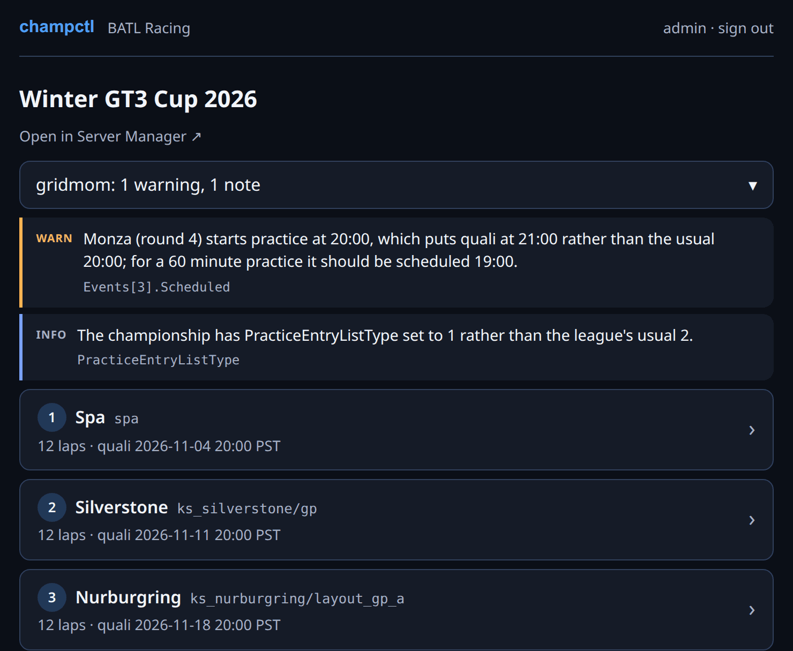
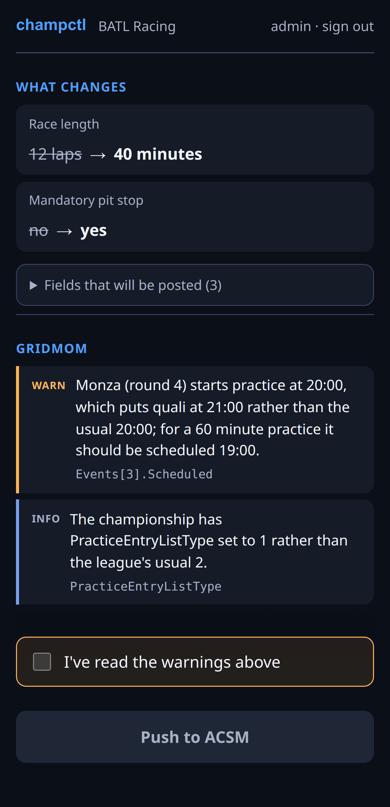
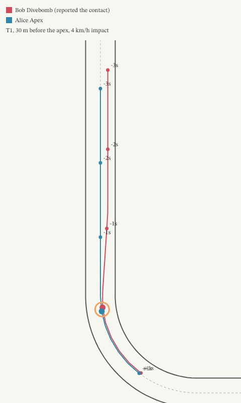
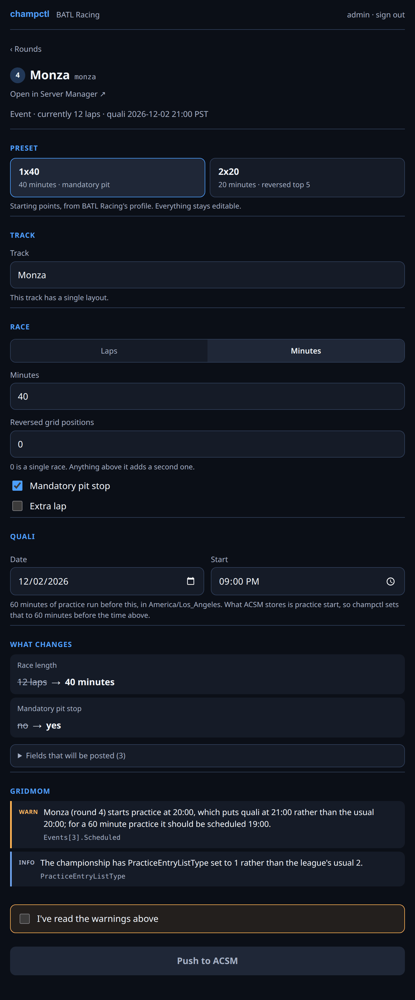
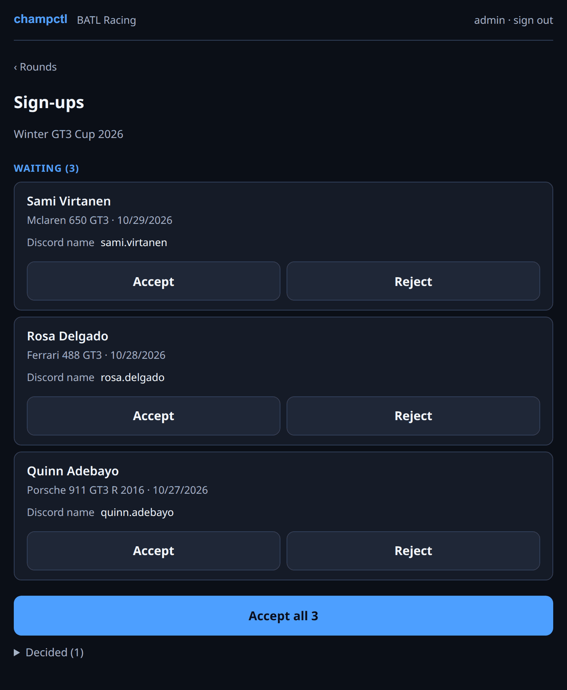
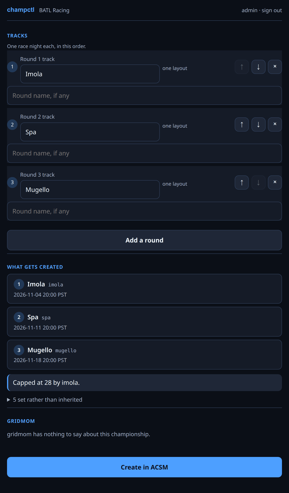

# acsm-champctl

[](https://github.com/mishan/acsm-champctl/actions/workflows/ci.yml)

Championship creation, validation and stats for Assetto Corsa Server Manager.
Built for BATL, usable by any league.

The commands:

| | |
|---|---|
| [`gridmom`](docs/commands.md#gridmom) | check a championship for the mistakes that ruin a race night |
| [`champctl-archive`](docs/commands.md#champctl-archive) | keep a copy of every export the league has ever run |
| [`champctl-finalize`](docs/commands.md#champctl-finalize) | set a race's format and push it |
| [`champctl-championship`](docs/commands.md#champctl-championship) | create a championship from a template |
| [`champctl-liveries`](docs/commands.md#champctl-liveries) | upload drivers' custom liveries and assign them |
| [`champctl-serve`](docs/commands.md#champctl-serve) | the finalize and create-a-championship flows as a web UI, for people without a terminal |
| [`champctl-upload`](docs/commands.md#champctl-upload) | take drivers' livery uploads from one-time links, holding no credentials |
| [`champctl-bot`](docs/commands.md#champctl-bot) | GridMom in Discord: reports, announcements, standings, liveries, incident votes, the season vote, the Racers role and the championship info |
| [`champctl-spectator`](docs/commands.md#champctl-spectator) | record every race, and find the incidents in it |
| [`champctl-mcp`](docs/commands.md#champctl-mcp) | answer questions about the league for an MCP client, read-only |

## What it looks like

`champctl-serve` against a Server Manager holding a made-up season, with
gridmom's findings opened above the rounds:



| | |
|---|---|
|  |  |
| Finalizing a round on a phone, since it gets opened from a Discord link | The drawing the stewards get with an incident report, beside the speeds, the gap, who moved and a suggested call |

<details>
<summary>More of the web UI</summary>

Finalizing a round: pick a format, see exactly what changes.



Accepting sign-ups.



Creating next season from this one.



</details>

gridmom on the command line, on a championship broken on purpose:

```text
$ gridmom check --file fixtures/synthetic/suzuka-duplicate-pitboxes.json
gridmom — BATL August 2026 (synthetic)

ERROR Suzuka's entry list has duplicate pit boxes at 3, 16 and 27. There are gaps at 10, 19 and 22 to move them into. Saving this event will drop 3 drivers from the list.
      Events[0].EntryList  entry.duplicate-pit-box
ERROR Nobody set the race length for suzuka (round 1).
      Events[0].RaceSetup.Sessions.Race  format.race-length-missing
WARN  Suzuka (round 1) starts practice at 19:30, which puts quali at 20:30 rather than the usual 20:00; for a 60 minute practice it should be scheduled 19:00.
      Events[0].Scheduled  schedule.derived-start
WARN  Imola (round 2) is a 40-lap single race but the pit window never opens, so there's no mandatory stop.
      Events[1].RaceSetup.RacePitWindowStart  format.pit-window-missing
…
```

## Install

Needs Node `>=22.13.0` — that floor is `node:sqlite`, which the archive and the
response cache use.

```sh
npm install
npm run gridmom -- check --file fixtures/synthetic/suzuka-duplicate-pitboxes.json
```

Installed, the commands are on your `PATH` by the names above. From a checkout,
`npm run gridmom -- <args>` is the same thing. Every command takes `--profile`
and `--base-url`; `--help` on any of them is authoritative.

## Documentation

| | |
|---|---|
| [docs/commands.md](docs/commands.md) | every command in detail |
| [docs/configuration.md](docs/configuration.md) | the league profile, pit counts, Discord ids, the environment |
| [docs/deployment.md](docs/deployment.md) | running it for a league: Docker, the reverse proxy, scheduled jobs, backups |
| [docs/discord-bot-setup.md](docs/discord-bot-setup.md) | GridMom from application to every optional feature |
| [docs/spectator.md](docs/spectator.md) | the race recorder and incident analysis |
| [docs/mcp.md](docs/mcp.md) | the MCP server |
| [docs/development.md](docs/development.md) | working on champctl itself, with [AGENTS.md](AGENTS.md) |

## Status

gridmom, the archive, and the finalize and championship engines are done and
driven by their CLIs. Finalizing, creating a championship, reordering its
rounds and accepting its sign-ups all have a web UI. GridMom runs BATL's Discord, and the recorder has
recorded its races since October 2026. What's left:

- **Reordering is web-only.** The engine is in `src/reorder/`, and nothing on
  the command line reaches it — unlike every other engine here, which has a CLI
  as its first front end.
- **The bot doesn't propose formats.** Incident votes and the season vote run
  as Discord polls; the format poll and the poll-to-proposal loop are not built,
  and neither are the `/stats` lookups, which want archive projections that
  don't exist yet.
- **Two livery questions are still open** (§10 of
  [the design](docs/discord-livery-upload.md)): an upload for a car with no
  skins on the server yet, and whether Content Manager overwrites a skin folder
  when a carset is installed again.
- **Standings come from the championship page.** `standings.json` wants a login
  the bot doesn't have, and champctl's own scorer declines most of BATL's
  championships, since reversed-grid rounds, drop-worst and fastest-lap points
  are unmeasured.
- **The nightly report has no memory.** It says the same thing every night until
  someone fixes it. A digest per championship in the archive database would let
  a league ask to be told once.
- **Only the web screens check installed content.** The CLI and the nightly
  report don't read the server's car and track listings, so their reports skip
  those checks.
- **Replays' steering and contact points are unconfirmed** against a real
  game; see the limits in [docs/spectator.md](docs/spectator.md).
- **No real export fixture.** Everything is tested against synthetic ones; the
  archive's first run produces a real one, it just needs sanitizing first.

The finer-grained gaps are under "Known gaps" in
[docs/development.md](docs/development.md); the original design is
[`acsm-champctl-plan.md`](acsm-champctl-plan.md).

## License

MIT — see [LICENSE](LICENSE). champctl is deliberately public so another league
can run it with its own profile; nothing here is BATL-specific except
`profiles/batl.json`.

Assetto Corsa Server Manager itself is separate software under its own terms,
and none of it is redistributed here. The premium build and its license key are
a per-purchase thing you supply yourself — see [`docker/README.md`](docker/README.md).
